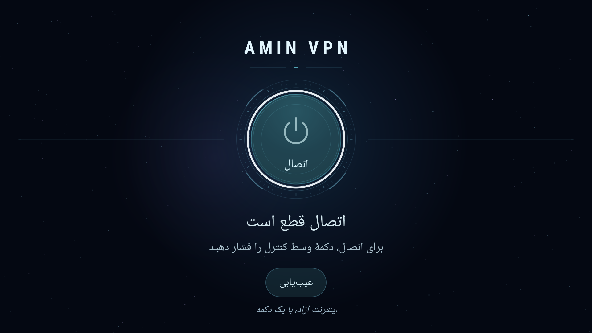
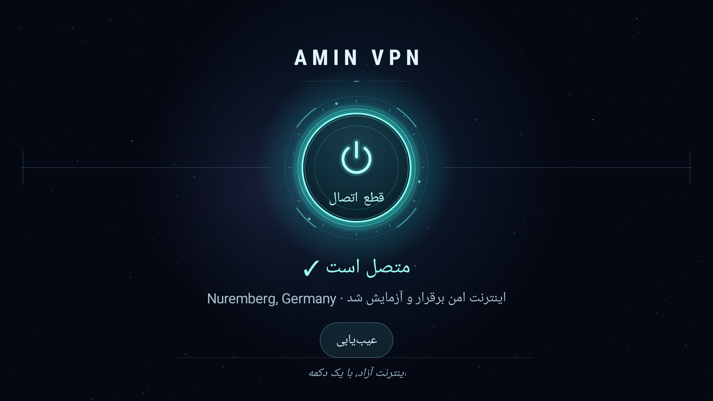

# Amin VPN 0.1.1 device test

Tested on 25 November 2026 using the connected Xiaomi MiTV-AFKR0, Android 11, with an ARMv7
userspace. All eight checks passed. The APK was downloaded from the public GitHub release and its
SHA-256 was checked against the signed build before installation.

| Build | Result |
| --- | --- |
| Application | `com.enigma.aminvpn` |
| Version | `0.1.1-armv7-experimental`, version code 3 |
| APK size | 15,822,115 bytes |
| APK SHA-256 | `3d61c12c904bdcecea5913fc58bb51f24d5f3509420070f8ac93b3990fac396b` |
| Android unit tests | 165 passed, zero failures, errors or skipped tests |
| Native checks | Pinned engine and privacy regression checks passed |
| Signing | APK signature verified against the saved release signing certificate |

[Successful build and tests](https://github.com/Skyspiriit/Vpn/actions/runs/45661058847)
and [published release](https://github.com/Skyspiriit/Vpn/releases/tag/v0.1.1-armv7-experimental).

| Device check | Result |
| --- | --- |
| Install, launch, Persian TV interface and remote focus | Passed |
| Real VPN, fresh DNS and independent HTTPS through the tunnel | Passed |
| Background use and reopening with the tunnel active | Passed |
| Graceful disconnect and reconnect, cycle 1 | Passed |
| Graceful disconnect and reconnect, cycle 2 | Passed |
| On-screen diagnostics and memory snapshot | Passed |
| Unexpected process loss removes the tunnel and reopening clears the connected indicator | Passed |
| Reconnect after process loss, then gracefully disconnect and restore ordinary internet | Passed |

The independent check ran in a separate Android test application. It required Android's active
network to report VPN transport, resolved `example.org` over that network, and bound HTTPS requests
to the same network. `https://example.org/` returned 200 and
`https://www.gstatic.com/generate_204` returned 204 with normal hostname and certificate validation.
The check also required the same network to remain active at the end. Equivalent checks passed
over the ordinary network before connection and after disconnect. The temporary helper was removed
when testing finished.

The app's measured times to its verified connected state were 10.113, 13.134, 13.334 and 8.871
seconds. A memory snapshot while connected showed 83,255 KiB PSS (about 81 MiB) and 185,720 KiB RSS
(about 181 MiB). These measurements describe the tested sessions and one memory snapshot.

## Actual device screenshots

Disconnected screen.

Connected screen captured after the tunnel verification passed.

## Scope

These were live tests on the connected TV's current network. Connectivity from Iran, physical
network roaming, throughput under video streaming load and the university Capsule sign-in flow
require separate trials. The release remains experimental.

The APK is unchanged from the published signed build. Version 0.1.1 uses a new release signing
key. A device with the earlier 0.1.0 experimental APK must remove that installation before
installing 0.1.1. Future releases use the saved 0.1.1 signing key.
